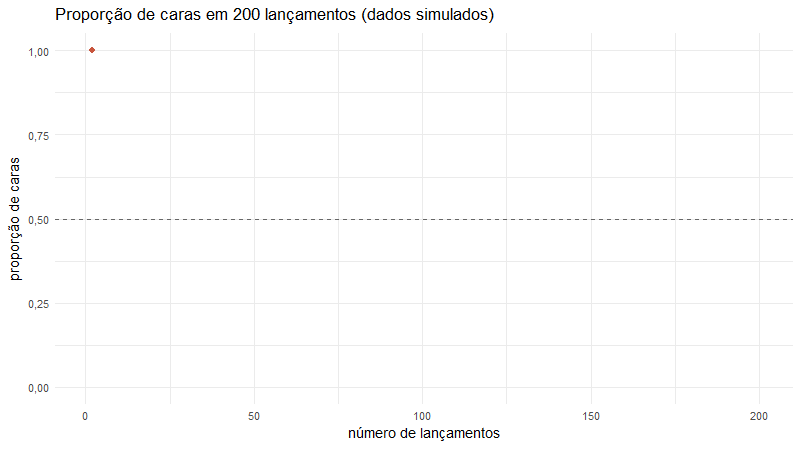

```{r}
#| include: false
# Dados SIMULADOS, os mesmos de ../c4-01-tocador (semente 2026).
set.seed(2026)
n <- 200L
x <- rbinom(n, size = 1, prob = 0.5)
prop <- cumsum(x) / seq_len(n)
stopifnot(isTRUE(all.equal(prop, vapply(seq_len(n), function(k) mean(x[1:k]), 0))))
ojs_define(prop = round(prop, 4), n_total = n)
final <- formatC(prop[n], format = "f", digits = 3, decimal.mark = ",")
```

## GIF feito com o gganimate

{fig-alt="Animação: a curva da proporção de caras oscila no começo e se aproxima de 0,5." width=75%}

## MP4 feito com o gganimate



## Controle deslizante em OJS

```{ojs}
//| echo: false
viewof k = Inputs.range([1, n_total], {value: 20, step: 1, label: "lançamentos", width: 520})
```

```{ojs}
//| echo: false
serie = Array.from({length: k}, (_, i) => ({lancamento: i + 1, proporcao: prop[i]}))
Plot.plot({
  width: 1000, height: 340, marginLeft: 70, marginBottom: 50, style: {fontSize: "20px"},
  x: {domain: [0, n_total], label: "número de lançamentos"},
  y: {domain: [0, 1], label: "proporção de caras"},
  marks: [Plot.ruleY([0.5], {strokeDasharray: "4"}), Plot.line(serie, {x: "lancamento", y: "proporcao", stroke: "#1d3b53"})]
})
```

```{ojs}
//| echo: false
virg = (x, d) => x.toFixed(d).replace(".", ",")
html`<p>Depois de ${k} lançamentos, a proporção de caras é ${virg(prop[k - 1], 3)}. No fim (${n_total} lançamentos): ${virg(prop[n_total - 1], 3)}.</p>`
```
